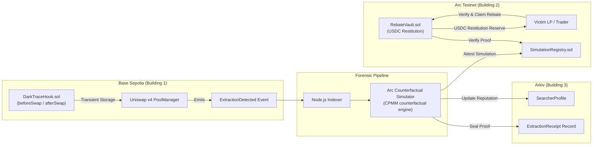
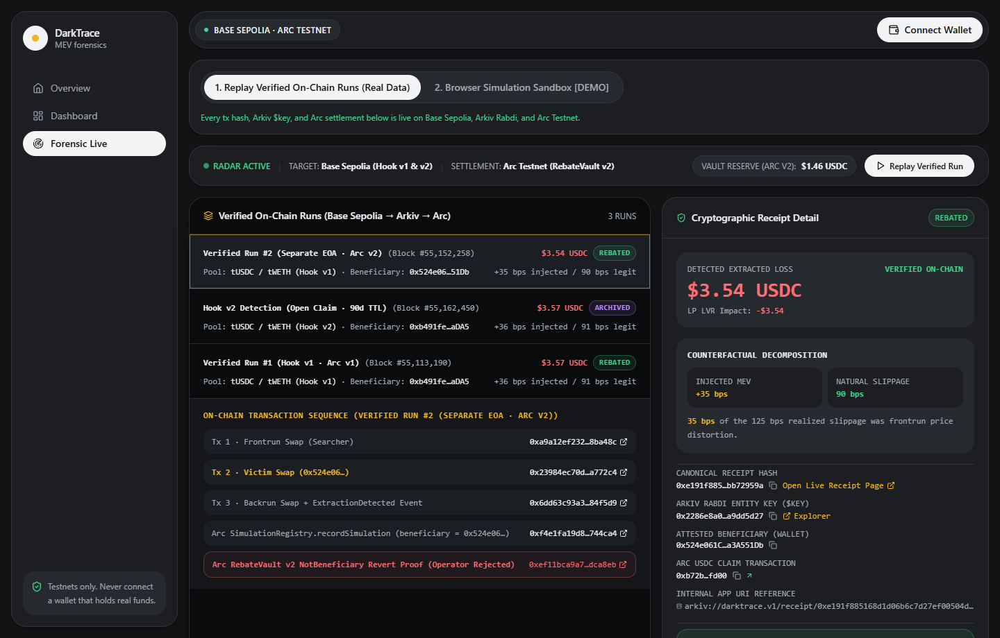
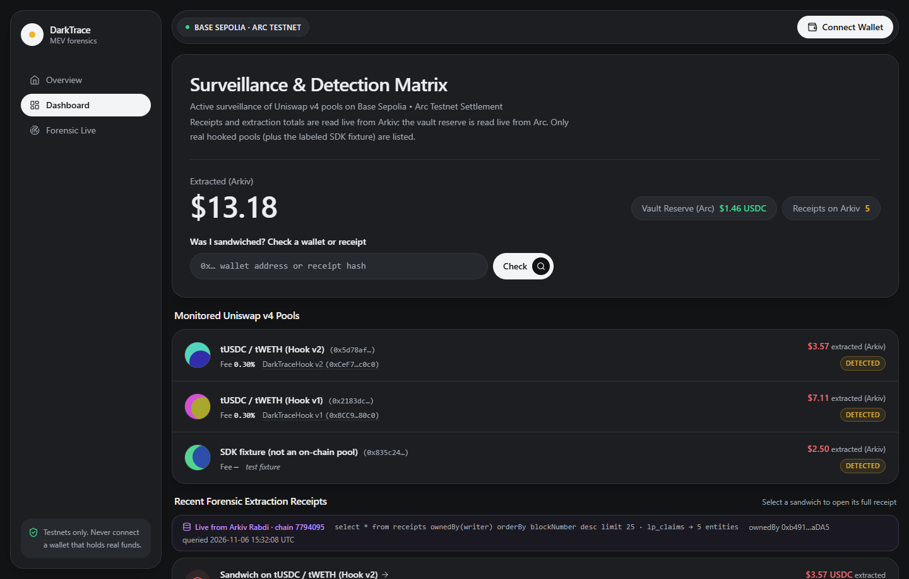
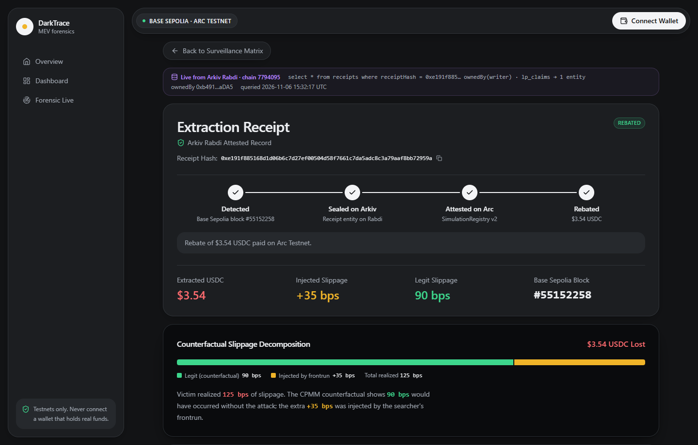

# DarkTrace

**MEV forensics and restitution for Uniswap v4 LPs.** A v4 hook fingerprints sandwich attacks on Base Sepolia. A counterfactual engine measures exactly how much the victim lost. Arkiv seals a verifiable receipt. Victims claim a USDC rebate on Arc Testnet.

> LPs and traders lose **over $1B a year** to MEV[^1]. DarkTrace measures that loss, proves it on-chain, and pays it back.

[^1]: LVR/MEV loss estimates vary by methodology; see Flashbots/RAMS and Dune MEV dashboards. DarkTrace uses "over $1B annually" as a conservative floor, not a canonical figure.

DarkTrace keeps detection and computation apart. Extraction fingerprinting happens **on-chain**, inside the hook, without touching swap execution. Loss computation happens **off-chain** and is deterministic. No step assumes synchronous cross-chain messaging.

**Live app:** [darktrace-lovat.vercel.app](https://darktrace-lovat.vercel.app) · **Arc Studio project:** [studio.arc.io/app/c3240360…](https://studio.arc.io/app/c3240360-99a1-4a97-b03e-5e547be78a32?thread=c19d8800-048f-459f-8329-54f1e7b50d34) · **Arkiv entity:** [rabdi explorer](https://rabdi.explorer.arkiv.network/entity/0xc327d5db4aa3098b80dc8729d090317408f98d19e1e19c13d6cf83494a05f8ca)

---

## Prize Tracks at a Glance

| Partner | What DarkTrace uses | Where to look |
| :--- | :--- | :--- |
| **Uniswap Foundation** | v4 hook (`beforeSwap` / `afterSwap`) with block-scoped transient-storage state for sandwich detection, at a CREATE2-mined address | [`contracts/src/DarkTraceHook.sol`](contracts/src/DarkTraceHook.sol), [`FEEDBACK.md`](FEEDBACK.md) |
| **Arkiv** | Every extraction receipt is written to Arkiv Rabdi with `@arkiv-network/sdk`, and every user-facing receipt view reads it back live | [Arkiv Integration](#arkiv-integration-rabdi-testnet-chain-7794095), [`/arkiv`](arkiv/README.md) |
| **Arc** | `SimulationRegistry` + `RebateVault` paying native USDC restitution, generated, tested and deployed in Arc Studio | [Arc Integration](#arc-integration-arc-testnet-chain-5042002), [`arc-studio/report.md`](arc-studio/report.md) |

---

## Architecture



**Flow:**
1. A swap in a hooked v4 pool runs through `DarkTraceHook`. The hook records each swap's tick movement. When it sees a frontrun → victim → backrun pattern in one block, it emits `ExtractionDetected`.
2. The indexer picks up the event. It prices the victim swap twice with the CPMM formula, once against the pre-attack reserves and once after the frontrun, and isolates the injected slippage.
3. The result is sealed as an `ExtractionReceipt` entity on Arkiv. The searcher's reputation profile is updated.
4. The simulation is attested in `SimulationRegistry` on Arc. `RebateVault` pays USDC only against an attested receipt, and only once per receipt.

---

## Product Preview

### 1. Interactive Forensic Terminal (`/demo`)
> **Guided walkthrough of sandwich detection, CPMM counterfactual slippage decomposition, and Arkiv proof verification.**

[](https://darktrace-lovat.vercel.app/demo)

<details>
<summary><b>View Surveillance Dashboard & Extraction Receipt Screenshots</b></summary>

### 2. Forensics Surveillance Matrix (`/dashboard`)
> **Monitored Uniswap v4 pools, the Arc vault's USDC reserve, and recent extraction receipts read live from Arkiv.**

[](https://darktrace-lovat.vercel.app/dashboard)

### 3. Extraction Receipt (`/receipt/0xe9e5…`)
> **Attested loss record: the 3-tx sandwich, the canonical `receiptHash`, the Arkiv entity key and owner, and an explorer deep-link.**

[](https://darktrace-lovat.vercel.app/receipt/0xe9e56b6adbf0cae90f08b28a0ae3dccd9fc4ece42eb7b0126e4f208646eae6ce)

</details>

---

## What Is Live vs. Simulated

Judges should be able to tell at a glance what runs for real.

| Component | Status |
| :--- | :--- |
| `DarkTraceHook`, `SearcherRegistry` on Base Sepolia | **Deployed** |
| `SimulationRegistry`, `RebateVault` on Arc Testnet | **Deployed.** v1 paid out **3.57 USDC** in Verified Run #1; beneficiary-gated v2 (`0xd501…61a2` / `0x238d…4d5b`) was topped up to **5.00 USDC**, blocked an unauthorized operator claim (`NotBeneficiary`), and **paid out 3.54 USDC to the separate Victim EOA** in Verified Run #2 (`1.460023 USDC` reserve remaining) |
| Indexer watching the hook | **Live** (`/api/indexer/health` reports the hook address and `arkivWriter`) |
| Arkiv receipts, claims & searcher profiles | **Live.** Written with the SDK (`30d` standard TTL, extended to `90d` for open claims), read by `/dashboard`, `/receipt`, `/pool`, `/searcher`, `/lp`, `/api/stats` (`ON-CHAIN` vs `SYNTHETIC [DEMO]` labeled in UI) |
| Arc vault USDC reserve & interactive claim | **Live.** On-chain `balanceOf` read in `/api/stats` and `/dashboard`; `/receipt/[hash]` includes a live wagmi **Claim Rebate** panel that checks `beneficiary` on Arc v2, calls `claimRebate`, and seals `LPClaim` on Arkiv |
| `/demo` walkthrough | **Dual-mode:** **(1) Replay Verified On-Chain Runs** (driven by real Base Sepolia, Arkiv, and Arc tx/entity data for Verified Run #2, Hook v2 Run, and Verified Run #1) and **(2) Browser Simulation Sandbox `[DEMO]`** |
| Off-chain linked-origin scanner | **Live in the indexer** (watches both hooked pools; `/api/indexer/health` → `linkedScanner`). Fork-proven with [`scripts/fork-proof-v2.sh`](scripts/fork-proof-v2.sh); no real split-contract sandwich has occurred on testnet yet |
| Escrow + expiry vault (`0x0897…E104`) | **Deployed and tested, not live:** holds 0 USDC and the app settles on v2 (`0x238d…4d5b`), which has no dispute window |
| Searcher bonds | **Live read** of `SearcherRegistry` (native ETH). No bond has been posted, so the UI shows `0.0000 ETH` |

---

## Detection Coverage

| Sandwich shape | Caught by | Evidence |
| :--- | :--- | :--- |
| Frontrun + backrun from the same contract, one bundle tx | Hook v1 and v2 (`ExtractionDetected`) | Verified run #1 (v1); hook v2 run `0xef69…51c8` |
| Same contract, **three separate txs** in one block | Hook v1 and v2 (block-scoped storage) | Verified run #2 on v1 (block 55,152,258); fork proof scenario A on **v2** |
| Frontrun and backrun from **different contracts**, same signing EOA (split-contract evasion) | **Off-chain linked-origin scanner** in the indexer (the hook v2 deliberately misses this; see [threat model §3](specs/08-hook-threat-model.md)) | Fork proof scenario B: hook silent, scanner finds it, receipt computed with `detection=linked-origin` |
| Frontrun and backrun from different EOAs and contracts | **Not caught** (indistinguishable from two independent traders without off-chain identity data) | Documented limitation |

Reproduce both fork scenarios against the real deployed hook v2 and pool, with no keys and nothing broadcast:

```bash
./scripts/fork-proof-v2.sh
```

---

## Prior Art & What's Different

| Project | Approach | Pays the victim? |
| :--- | :--- | :--- |
| [MEV Blocker](https://docs.mevblocker.io/) / [Flashbots Protect](https://docs.flashbots.net/flashbots-protect/mev-share) | Private RPC prevents sandwiches; shares backrun rebates | Small backrun rebates; no per-sandwich restitution |
| [Angstrom](https://mirror.xyz/0x1b6Fc245e8e067060b982094E9a8bbaF1D199497/rvV1Ln7_NtWl3hEmZzWORFHVvg7qCYgdFk1lnFPZ6rE) (Sorella) | v4 hook, uniform per-block price removes sandwiches in its pools | Prevention, not restitution |
| [EigenPhi](https://eigenphi-1.gitbook.io/arbitrage-scan-user-guide/sandwich) | Sandwich analytics and victim leaderboards | No |
| [MEVictim Rebate](https://ethglobal.com/showcase/mevictim-rebate-qsxak) (ETHGlobal NY 2023 finalist) | Subgraph + Axiom ZK proof of victimhood, soulbound NFT | No (rebates were not built) |
| [meva](https://ethglobal.com/showcase/meva-54k1t) (HackMoney 2026) | Hook taxes scored bots; 30% to victims | Designed, from bot tax |
| **DarkTrace** | Hook + off-chain linked-origin detection, loss rebuilt from PoolManager events, Arkiv receipt, beneficiary-gated USDC | **Yes, twice on testnet** (3.57 and 3.54 USDC); the second to the victim's own wallet, after the operator's claim reverted on-chain |

DarkTrace is restitution, not prevention: it complements private RPCs and prevention hooks for pools that want a verifiable "victims get repaid" guarantee.

---

## Trust Model & Known Limitations

- **Single attester.** `SimulationRegistry` attestations come from one owner key (`0xb491…aDA5`), which also owns the vault and can `emergencyWithdraw`. Anyone can recompute the loss from the Arkiv receipt and the Base txs, but nothing on-chain enforces it yet. The escrow vault's dispute window is the next step, and ZK or optimistic proofs the long-term one.
- **Funding.** The vault is funded by the operator on testnet. Slashing `SearcherRegistry` bonds or taking a hook-fee share into the vault is designed, not built.
- **Scripted attacks.** Both verified runs were executed by us on testnet. In run #2 the victim wallet is a separate EOA, but its key is derived from the operator key (`deriveVictimPrivateKey`), so both sides are still ours.
- **Counterfactual scope.** Exact within one liquidity range; swaps that cross initialized ticks are not modelled yet.
- **Detection gaps.** See the last row of Detection Coverage. Hook state holds one candidate per pool per block.
- **Arc Studio.** The Studio deployment (`0x5279…` / `0x6760…`) is the v1 schema, holds no funds, and is not used by the app (its deployer key cannot be exported).

---

## Deployed Addresses & Contracts

| Network | Contract / Component | Address | Description |
| :--- | :--- | :--- | :--- |
| **Base Sepolia** | Uniswap v4 `PoolManager` | `0x05E73354cFDd6745C338b50BcFDfA3Aa6fA03408` | Canonical v4 Pool Manager |
| **Base Sepolia** | `DarkTraceHook` v2 | `0xCeF7a999885D93f23Beeb7D319A83F2949B2c0c0` | Hook v2 (`0x00C0` flags, salt `0x180d`): explicit owner, `BalanceDelta` profit-consistency check, `-53.7%` clean-swap gas, opt-in `hookData` victim attribution (detected tx [`0xef694630…20a051c8`](https://base-sepolia.blockscout.com/tx/0xef694630199a91f86c1b8cdae55b0f3192373d7e776d7d3032fd2aa120a051c8), pool `0x5d78af67…1afc63df`, receipt [`$key 0x259dc288…0fd2`](https://rabdi.explorer.arkiv.network/entity/0x259dc2884aab483503458ce1ebb716c4e90bf156eadfaaa2e9761d2ec60b0fd2)) |
| **Base Sepolia** | `DarkTraceHook` v1 | `0xBCC9e1C474Ed195b3791f2c41EdAC2a25c5b80c0` | Hook v1 (`0x00C0` flags, salt `0x139d`; used by Verified Runs #1 & #2 on pool `0x2183dce5…c676c`) |
| **Base Sepolia** | `SearcherRegistry` | `0x24A2669C706CCE71BAea24a4De18D9D215713551` | Searcher bond escrow and owner-governed slashing |
| **Arc Testnet** | `SimulationRegistry` v2 (Foundry) | `0xd501D47b246438A18C8a0BFFCF10338CfBB661a2` | Active attestation registry (beneficiary-gated; used by Verified Run #2) |
| **Arc Testnet** | `RebateVault` v2 (Foundry) | `0x238dE56E52A3F6C6708952052e6a20E5102b4d5b` | Active settlement vault (paid `3.539977 USDC` to Victim EOA in Verified Run #2; `1.460023 USDC` reserve remaining) |
| **Arc Testnet** | `SimulationRegistry` v2 Escrow + Expiry | `0x31d51d7d05CE62030CBABF57D0f5376b86C70E77` | Escrow dispute window (`flagDispute` / `resolveDispute`) + claim expiry tracking (verified in txs [`0x5f858712…`](https://explorer.testnet.arc.io/tx/0x5f858712f594e689444cdbe11ba57e1742af70afbd01f73ef1ff3946230f3d34), [`0x0915cb01…`](https://explorer.testnet.arc.io/tx/0x0915cb01c4c655e6d219d6c31c6b67edbd0d6eb8d12743aae1b81cfb55daba60), [`0x8aa76387…`](https://explorer.testnet.arc.io/tx/0x8aa763876c395f41829a1e5ffcfbe1acda5d567401615f2669b20fa96f91801d)) |
| **Arc Testnet** | `RebateVault` v2 Escrow + Expiry | `0x0897Cc21DaD8aC9Fe5Deb4971e2f8c390E7BE104` | Enforces `DisputeWindowActive`, `AttestationDisputed`, `ClaimExpired`, and `expireUnclaimedRebate` on-chain USDC reserve recycling |
| **Arc Testnet** | `SimulationRegistry` v1 (Foundry, retired) | `0xb8416cb4d82BA72b70C3EC55d7AC66b5DB415CF8` | Retired (used by verified run #1; attestation `0x50ab85ca…d9eec9`) |
| **Arc Testnet** | `RebateVault` v1 (Foundry, retired) | `0x2ab745F51002Ce236A9A2dA81cDaA553B87f28CD` | Retired (used by verified run #1; paid `3.571583 USDC` in `0x4202622d…a4963f`, remaining `1.428417 USDC` migrated to v2) |
| **Arc Testnet** | `SimulationRegistry` (Arc Studio) | `0x52794Da13E573c9e73D32248a286843418Ba2983` | Generated, tested and deployed in Arc Studio (v1 schema) |
| **Arc Testnet** | `RebateVault` (Arc Studio) | `0x676065eb7c72ddf2048f21e6cb2ca6721827c1de` | Generated, tested and deployed in Arc Studio (v1 schema) |
| **Arc Testnet** | Arc native USDC (ERC-20) | `0x3600000000000000000000000000000000000000` | Native 6-decimal USDC interface |
| **Arkiv (Rabdi, 7794095)** | Namespace | `darktrace.v1` | `ExtractionReceipt` / `SearcherProfile` / `LPClaim` |
| **Arkiv (Rabdi, 7794095)** | Writer wallet | `0xb491fe5846DE735B6Cb03a677A3C6296FAB0aDA5` | Only entities owned by this wallet are trusted on read |
| **Arkiv (Rabdi, 7794095)** | Verified run #2 receipt entity (v2) | `0x2286e8a00e389f51ea21e3d5280f2078b54b4b2456842783962416c1a9dd5d27` | Viewable on [`rabdi.explorer.arkiv.network`](https://rabdi.explorer.arkiv.network/entity/0x2286e8a00e389f51ea21e3d5280f2078b54b4b2456842783962416c1a9dd5d27) |
| **Arkiv (Rabdi, 7794095)** | Verified run #2 claim entity (v2) | `0x45dcfc2de3a9b1e6738ef67dcfa323c202f28683da820c35cf0f27d3b6d89a35` | Viewable on [`rabdi.explorer.arkiv.network`](https://rabdi.explorer.arkiv.network/entity/0x45dcfc2de3a9b1e6738ef67dcfa323c202f28683da820c35cf0f27d3b6d89a35) |
| **Arkiv (Rabdi, 7794095)** | Verified run #1 receipt entity (v1) | `0x837ad00cd5fba8b67ba3976cbbca64de32d4ddac8483bb6b56b6866f67b432a8` | Viewable on [`rabdi.explorer.arkiv.network`](https://rabdi.explorer.arkiv.network/entity/0x837ad00cd5fba8b67ba3976cbbca64de32d4ddac8483bb6b56b6866f67b432a8) |
| **Arkiv (Rabdi, 7794095)** | Verified run #1 claim entity (v1) | `0x20d3a7149d2912642cc7dedf994454a48dc6c1f480bb81bf007de5c788985fd5` | Viewable on [`rabdi.explorer.arkiv.network`](https://rabdi.explorer.arkiv.network/entity/0x20d3a7149d2912642cc7dedf994454a48dc6c1f480bb81bf007de5c788985fd5) |
| **Arkiv (Rabdi, 7794095)** | Sample entity key | `0xc327d5db4aa3098b80dc8729d090317408f98d19e1e19c13d6cf83494a05f8ca` | Viewable on [`rabdi.explorer.arkiv.network`](https://rabdi.explorer.arkiv.network/entity/0xc327d5db4aa3098b80dc8729d090317408f98d19e1e19c13d6cf83494a05f8ca) |

---

## Arkiv Integration (Rabdi testnet, chain 7794095)

- **Namespace:** `darktrace.v1`
- **Writer wallet:** `0xb491fe5846DE735B6Cb03a677A3C6296FAB0aDA5`
- **Entities:** `ExtractionReceipt`, `SearcherProfile`, `LPClaim`. SDK schemas are in [`lib/arkiv/sdk.ts`](lib/arkiv/sdk.ts).
- **Written by** the indexer ([`apps/indexer/src/pipeline.ts`](apps/indexer/src/pipeline.ts)) via `createEntity` for every detected extraction. This requires `ARKIV_PRIVATE_KEY`.
- **Read by** `/dashboard`, `/receipt/[hash]`, `/pool/[id]`, `/searcher/[address]`, `/lp/[address]` and `/api/stats`.
  - Each queries Arkiv server-side on every request, filtered to the writer wallet.
  - Each shows a **"Live from Arkiv Rabdi"** strip with the query it ran.
  - If Arkiv is unreachable, the page shows an error. It never falls back to mock data.
- **Docs:** [`schema.md`](arkiv/schema.md) (schemas, indexing, expiry) · [`how-you-use-arkiv.md`](arkiv/how-you-use-arkiv.md) · [`why-arkiv.md`](arkiv/why-arkiv.md) · [`reach.md`](arkiv/reach.md) · [`friction.md`](arkiv/friction.md)

**Query judges can run.** Node ≥ 22 with `@arkiv-network/sdk` and `viem` installed. `ARKIV_ACCESS_KEY` is optional; without it you use the rate-limited public endpoint.

```typescript
import { http } from "viem";
import { createPublicClient } from "@arkiv-network/sdk";
import { rabdi } from "@arkiv-network/sdk/chains";
import { eq } from "@arkiv-network/sdk/query";

const client = createPublicClient({
  chain: rabdi({ accessKey: process.env.ARKIV_ACCESS_KEY ?? "" }),
  transport: http(),
});

const res = await client
  .select({ $key: true, $owner: true, receiptHash: true, poolId: true, searcher: true, victim: true, extractedUSDC: true })
  .where(eq("receiptHash", "0xe9e56b6adbf0cae90f08b28a0ae3dccd9fc4ece42eb7b0126e4f208646eae6ce"))
  .fetch();

console.log(res.entities[0]); // $key 0xc327d5db…f8ca, $owner 0xb491…aDA5, extractedUSDC 1.25
```

Or, from this repo:

```bash
pnpm arkiv:verify       # read-only, no key needed: receipt by hash, by pool, by searcher, recent
pnpm arkiv:write-test   # needs ARKIV_PRIVATE_KEY: writes one receipt and reads it back
```

---

## Arc Integration (Arc Testnet, chain 5042002)

- **Arc Studio project:** [studio.arc.io/app/c3240360-99a1-4a97-b03e-5e547be78a32](https://studio.arc.io/app/c3240360-99a1-4a97-b03e-5e547be78a32?thread=c19d8800-048f-459f-8329-54f1e7b50d34)
- **Generated in Studio** from [`arc-studio/prompt.md`](arc-studio/prompt.md): `SimulationRegistry` and `RebateVault`, plus a Foundry suite (unit, fuzz, invariant and reentrancy tests). The suite passed in Studio.
- **Deployed from Studio:** `SimulationRegistry` `0x52794Da1…2983` and `RebateVault` `0x676065eb…c1de`.
- **Settlement asset:** Arc native USDC (`0x3600…0000`, 6 decimals).
- **What the vault enforces:**
  - **only the victim can claim (v2):** each attestation names a `beneficiary` (the wallet that signed the victim's swap), and `claimRebate` reverts with `NotBeneficiary` for anyone else, so knowing a receipt hash is not enough to take its rebate. The beneficiary chooses where the USDC goes.
  - **escrow dispute window (`disputeWindowSeconds`):** attestations are claimable only after `claimableAt = attestedAt + disputeWindowSeconds`. Authorized challengers or the owner can call `flagDispute(receiptHash, reason)` in the window (`AttestationDisputed`), and the owner can uphold (with adjusted USDC) or revoke via `resolveDispute`.
  - **claim expiry & on-chain reserve recycling (`claimExpirySeconds`):** unclaimed rebates expire at `expiresAt = claimableAt + claimExpirySeconds` (`ClaimExpired`). Anyone can call `expireUnclaimedRebate(receiptHash)` after expiry to recycle unclaimed rebate liabilities back into the vault's active USDC reserve (`totalExpiredUSDC` vs `totalClaimedUSDC` tracked on-chain).
  - pays only against a receipt attested in `SimulationRegistry`
  - never pays more than the attested amount
  - pays each receipt at most once (replay nullifier)
  - checks-effects-interactions with a reentrancy guard
  - blocks self-payout
- **Live app settlement vs. Arc Studio deployment:** Arc Studio deploys from a cloud-custodied key (`0x5B12Ce46C7194aD57d143bC22847224047b1Ef42`) that cannot be exported and provides no post-deploy console to call `transferOwnership(0xb491…aDA5)`. Because `recordSimulation` is `onlyOwner`, the live app and indexer (`0xb491…aDA5`) settle against our self-custodied Foundry v2 deployment (`0xd501…61a2` / `0x238d…4d5b`, funded with 5.00 USDC), while the v2 Escrow + Claim Expiry contracts (`0x31d5…0E77` / `0x0897…E104`) and [`arc-studio/prompt.md`](arc-studio/prompt.md) carry the full dispute-window and expiry suite. Details: [`arc-studio/report.md`](arc-studio/report.md).
- **v1 → v2 migration:** the v1 Foundry vault (`0x2ab7…28CD`) did not check who was claiming. [`DeployArcV2.s.sol`](contracts/script/DeployArcV2.s.sol) deployed the beneficiary-gated v2 registry (`0xd501…61a2`) and vault (`0x238d…4d5b`), and the remaining `1.428417 USDC` reserve was migrated from v1 to v2 ([withdraw tx](https://explorer.testnet.arc.io/tx/0xacb28962d8b908e7a74ecea07f0fb036dfa4b694dba63fac1e47a89eb755c503) → [deposit tx](https://explorer.testnet.arc.io/tx/0xb8ac54e9d1c3cd73804330d6fe0e67f5712056768a9d7ca8b36089c13e3d36fa)). The indexer detects the registry version and attests with a beneficiary on v2.

---

## Local Development Quickstart

### Prerequisites
- Node.js ≥ 20 (≥ 22 to run the Arkiv SDK scripts) and `pnpm` 9.1.4
- Foundry (`forge`, `cast`, `anvil`)
- Docker & Docker Compose (optional, for the containerized indexer)

### Commands
```bash
# 1. Install dependencies deterministically
pnpm install --frozen-lockfile

# 2. Run Foundry smart contract tests
pnpm contracts:test

# 3. Run TypeScript test suites (simulator, arkiv, indexer)
pnpm test

# 4. Start the Next.js web app
pnpm dev

# 5. Optional: run the indexer daemon in Docker
docker compose build
docker compose up -d
curl http://localhost:8080/health
docker compose down
```

Copy [`.env.example`](.env.example) to `.env` first. Reads from Arkiv need no key. The indexer needs `ARKIV_PRIVATE_KEY` to write; set `ARKIV_DEV_MODE=memory` for offline runs.

---

## How the Demo Works

Visit [`/demo`](https://darktrace-lovat.vercel.app/demo) for a guided forensic walkthrough:
1. **Trigger sandwich:** replays a 3-tx sequence (frontrun swap, victim swap, backrun swap) against a Uniswap v4 pool.
2. **Forensic fingerprint:** the hook sees the same-block tick push and reversal, and emits `ExtractionDetected`.
3. **Counterfactual engine:** splits the victim's slippage into normal liquidity slippage (**12 bps**) and injected MEV slippage (**187 bps**), giving a **$1.25 USDC** restitution.
4. **Arkiv attestation:** the receipt is sealed as an `ExtractionReceipt` entity. Open it from the dashboard to see it read back live.
5. **Rebate claim:** the LP previews restitution against `RebateVault.sol` on Arc Testnet. The walkthrough simulates settlement in the browser and does not broadcast the transaction.

---

## Real End-to-End Run

`/demo` is a browser walkthrough. This command runs the **real** pipeline on testnets, with no simulated steps:

```bash
PRIVATE_KEY=0x… pnpm e2e:real    # the DarkTrace writer wallet (0xb491…aDA5)
```

1. **Arc v2 vault top-up & separate identities:** [`e2e-sandwich.ts`](apps/indexer/src/e2e-sandwich.ts) ensures `RebateVault` v2 holds `5.00 USDC` and prepares two distinct funded accounts: the searcher/operator (`0xb491…aDA5`) and a separate Victim EOA (`0x524e…51Db`, `beneficiary ≠ operator`).
2. **Base Sepolia (3 separate transactions in one block):** broadcasts `tx1` (operator frontrun via `searcherRouter`), `tx2` (Victim EOA swap via `victimRouter`), and `tx3` (operator backrun via `searcherRouter`) ordered by priority fee in a single block.
3. **Hook:** `tx3` emits `ExtractionDetected` naming the searcher and victim routers.
4. **Indexer:** [`onchain.ts`](apps/indexer/src/onchain.ts) rebuilds the three swaps from `PoolManager` `Swap` events, resolves `victimOrigin = getTransaction(tx2).from` (`0x524e…51Db`), and runs the CPMM counterfactual.
5. **Arkiv + Arc v2:** seals the `ExtractionReceipt` on Arkiv and attests it in `SimulationRegistry` v2 with `beneficiary = 0x524e…51Db`.
6. **Beneficiary-gated rebate:** [`claim.ts`](apps/indexer/src/claim.ts) first proves that the operator (`0xb491…aDA5`) reverts with `NotBeneficiary` when attempting `claimRebate`, then signs `claimRebate` with the Victim EOA (`0x524e…51Db`) and seals the `LPClaim` on Arkiv.

### Verified run #2 (v2 — separate searcher & victim EOAs, settled on Arc v2)

| Step | Network | Evidence |
| :--- | :--- | :--- |
| Vault top-up: `RebateVault` v2 (`0x238d…4d5b`) topped up by `3.571583 USDC` (`1.43 → 5.00 USDC`) | Arc Testnet | [`0x001aa60f…5563de`](https://explorer.testnet.arc.io/tx/0x001aa60f8d4338aa66c25ff981d6c960b17e6f11bcaa9dcc2b61693ad55563de) |
| Frontrun (`tx1`, idx 2): Operator `0xb491…aDA5` swaps `200 tUSDC → tWETH` via `searcherRouter` | Base Sepolia, block 55,152,258 | [`0xa9a12ef2…8ba48c`](https://sepolia.basescan.org/tx/0xa9a12ef232d1df4a38a56cf10ef5566f71a36798b4b4109eebf89a05658ba48c) ([Blockscout](https://base-sepolia.blockscout.com/tx/0xa9a12ef232d1df4a38a56cf10ef5566f71a36798b4b4109eebf89a05658ba48c)) |
| Victim swap (`tx2`, idx 3): **Victim EOA `0x524e…51Db`** swaps `1,000 tUSDC → tWETH` via `victimRouter` | Base Sepolia, block 55,152,258 | [`0x23984ec7…a772c4`](https://sepolia.basescan.org/tx/0x23984ec70d7fc514697be40d8bb7500941ecbed350181a75b7fcb79e7ea772c4) ([Blockscout](https://base-sepolia.blockscout.com/tx/0x23984ec70d7fc514697be40d8bb7500941ecbed350181a75b7fcb79e7ea772c4)) |
| Backrun (`tx3`, idx 4): Operator `0xb491…aDA5` swaps `0.06518 tWETH → tUSDC`; `DarkTraceHook` emits `ExtractionDetected` (`proofHash 0x63c9…97d7`) | Base Sepolia, block 55,152,258 | [`0x6dd63c93…84f5d9`](https://sepolia.basescan.org/tx/0x6dd63c93a3945d7f737b64350f480cbafc3a5032b0442b3dbef4c6d72f84f5d9) ([Blockscout](https://base-sepolia.blockscout.com/tx/0x6dd63c93a3945d7f737b64350f480cbafc3a5032b0442b3dbef4c6d72f84f5d9)) |
| `ExtractionReceipt` sealed: **3.54 USDC** loss, 35 bps injected / 90 bps legit, 3 distinct `txHashes`, `lp = 0x524e…51Db` | Arkiv Rabdi | [`$key 0x2286e8a0…5d27`](https://rabdi.explorer.arkiv.network/entity/0x2286e8a00e389f51ea21e3d5280f2078b54b4b2456842783962416c1a9dd5d27) · [receipt view](https://darktrace-lovat.vercel.app/receipt/0xe191f885168d1d06b6c7d27ef00504d58f7661c7da5adc8c3a79aaf8bb72959a) |
| `SimulationRegistry` v2 (`0xd501…61a2`) `recordSimulation`: `3,539,977` raw USDC attested to `beneficiary = 0x524e061C89036b12a4f377bD8999038Da3A551Db` | Arc Testnet | [`0xf4e1fa19…744ca4`](https://explorer.testnet.arc.io/tx/0xf4e1fa19d88a7151ba7c2d43a525daafecffca1e29d290a7eb4059d521744ca4) |
| `RebateVault` v2 (`0x238d…4d5b`) `NotBeneficiary` guard: Operator `0xb491…aDA5` claim attempt **reverts `NotBeneficiary` on-chain** | Arc Testnet | [`0xef11bca9…dca8eb`](https://explorer.testnet.arc.io/tx/0xef11bca9a7f4b64983a2404834cdf1c817c1aeda334a73f0958cfa3aeddca8eb) |
| `RebateVault` v2 (`0x238d…4d5b`) `claimRebate`: **Victim EOA `0x524e…51Db` claims 3.539977 USDC**, reserve `5.00 → 1.460023 USDC` | Arc Testnet | [`0xb72bd280…f1fd00`](https://explorer.testnet.arc.io/tx/0xb72bd280acafa1f1cec3f6738066070e1bc0940408348ed530fb54b39df1fd00) |
| `LPClaim` sealed: links receipt `0xe191…959a` (`lp 0x524e…51Db`) to Arc claim tx `0xb72b…fd00` (status `REBATED`) | Arkiv Rabdi | [`$key 0x45dcfc2d…9a35`](https://rabdi.explorer.arkiv.network/entity/0x45dcfc2de3a9b1e6738ef67dcfa323c202f28683da820c35cf0f27d3b6d89a35) |

Both the searcher EOA (`0xb491…aDA5`) and the victim EOA (`0x524e…51Db`) are scripted by [`e2e-sandwich.ts`](apps/indexer/src/e2e-sandwich.ts) for repeatable testnet verification, but they sign separate transactions from separate wallets so `beneficiary ≠ operator` is enforced end-to-end on-chain.

### Verified run #1 (Nov 6, 2026 — settled on Arc v1)

| Step | Network | Evidence |
| :--- | :--- | :--- |
| Sandwich bundle: frontrun 200 → victim 1,000 → backrun, all tUSDC. Searcher +2.43 tUSDC after fees | Base Sepolia, block 55,113,190 | [`0x1adc35cf…a410b4`](https://sepolia.basescan.org/tx/0x1adc35cf1d5c726c853dea8de8401cc52d07689e7c52770b5b543c1ea3a410b4) ([Blockscout](https://base-sepolia.blockscout.com/tx/0x1adc35cf1d5c726c853dea8de8401cc52d07689e7c52770b5b543c1ea3a410b4)) |
| `DarkTraceHook` emits `ExtractionDetected`: searcher `0xc315…940D`, victim `0x9428…2488` | Base Sepolia | Same tx, pool `0x2183dce5…c676c` |
| `ExtractionReceipt` sealed: **3.57 USDC** loss, 36 bps injected / 91 bps legit, real tx hashes | Arkiv Rabdi | [`$key 0x837ad00c…32a8`](https://rabdi.explorer.arkiv.network/entity/0x837ad00cd5fba8b67ba3976cbbca64de32d4ddac8483bb6b56b6866f67b432a8) · [receipt view](https://darktrace-lovat.vercel.app/receipt/0xdf3305cb8962998d3f887ad00ee3d206948d4b36703f6be39c9e65c9dee4e681) |
| `SimulationRegistry` (v1) `recordSimulation`: 3,571,583 raw USDC attested | Arc Testnet | [`0x50ab85ca…d9eec9`](https://explorer.testnet.arc.io/tx/0x50ab85caa05a7e52e9b9e5b498faf8c67981c1ba013060a068f7ef43cfd9eec9) |
| `RebateVault` (v1) `claimRebate`: **3.571583 USDC paid**, reserve 5.00 → 1.43 | Arc Testnet | [`0x4202622d…a4963f`](https://explorer.testnet.arc.io/tx/0x4202622d97af28edd3439a8f3f5ab773524755362357aa22d4c6bfb100a4963f) |
| `LPClaim` sealed: links receipt `0xdf33…e681` to Arc claim tx `0x4202…963f` (status `REBATED`) | Arkiv Rabdi | [`$key 0x20d3a714…5fd5`](https://rabdi.explorer.arkiv.network/entity/0x20d3a7149d2912642cc7dedf994454a48dc6c1f480bb81bf007de5c788985fd5) |

Both sides of this sandwich are controlled by the operator. It is a scripted, real on-chain attack for verification, sized so that the searcher profits after fees and the victim's loss (about $3.6) is fully repayable from the vault reserve.

---

## Testnet Disclaimer

All contracts, tokens and data feeds run on Base Sepolia, Arc Testnet and Arkiv Rabdi testnet only. No real user funds or mainnet assets are involved.

---

## Submission Artifacts & Evidence

- **Link audit & verification matrix:** [`docs/evidence/link-audit.md`](docs/evidence/link-audit.md)
- **Visual evidence & screenshots:** [`docs/screenshots/README.md`](docs/screenshots/README.md)
- **Uniswap Foundation feedback:** [`FEEDBACK.md`](FEEDBACK.md)
- **Arc Studio package & test report:** [`arc-studio/report.md`](arc-studio/report.md)
- **Arkiv integration package:** [`arkiv/README.md`](arkiv/README.md)
- **Final submission checklist:** [`specs/submission/FINAL-SUBMISSION-CHECKLIST.md`](specs/submission/FINAL-SUBMISSION-CHECKLIST.md)
- **Booth Q&A sheet:** [`specs/submission/qa-prep.md`](specs/submission/qa-prep.md)
- **2–3 min video script:** [`specs/06-demo-script.md`](specs/06-demo-script.md)

---

## Specification Documents

The full specifications are in [`/specs`](specs):
- [`00-plan.md`](specs/00-plan.md): hackathon execution plan
- [`01-architecture.md`](specs/01-architecture.md): technical architecture and boundary guarantees
- [`02-hook-design.md`](specs/02-hook-design.md): Uniswap v4 hook transient-storage design
- [`03-arc-simulator.md`](specs/03-arc-simulator.md): counterfactual LVR math
- [`04-arkiv-schema.md`](specs/04-arkiv-schema.md): Arkiv forensic schema
- [`05-ui-ux.md`](specs/05-ui-ux.md): forensic terminal styling guidelines
- [`06-demo-script.md`](specs/06-demo-script.md): 3-minute video script
- [`07-deployment.md`](specs/07-deployment.md): reproducible deployment instructions
- [`08-hook-threat-model.md`](specs/08-hook-threat-model.md): Hook v1 → v2 threat model, false-positive/false-negative analysis, and gas benchmarks

---

## AI Attribution

In line with ETHGlobal Mumbai 2026 transparency rules, AI-assisted and human contributions are recorded per file in [`AI_ATTRIBUTION.md`](AI_ATTRIBUTION.md).

---

## License

[MIT](LICENSE) © 2026 DarkTrace Contributors
