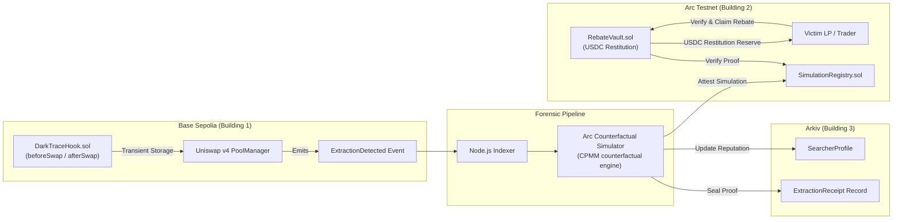

# DarkTrace

**MEV forensics and restitution for Uniswap v4 LPs.** A v4 hook fingerprints sandwich attacks on Base Sepolia. A counterfactual engine measures exactly how much the victim lost. Arkiv seals a verifiable receipt. Victims claim a USDC rebate on Arc Testnet.

> LPs and traders lose **over $1B a year** to MEV[^1]. DarkTrace measures that loss, proves it on-chain, and pays it back.

[^1]: LVR/MEV loss estimates vary by methodology; see Flashbots/RAMS and Dune MEV dashboards. DarkTrace uses "over $1B annually" as a conservative floor, not a canonical figure.

DarkTrace keeps detection and computation apart. Extraction fingerprinting happens **on-chain**, inside the hook, without touching swap execution. Loss computation happens **off-chain** and is deterministic. No step assumes synchronous cross-chain messaging.

**Live app:** [darktrace-lovat.vercel.app](https://darktrace-lovat.vercel.app) · **Arc Studio project:** [studio.arc.io/app/c3240360…](https://studio.arc.io/app/c3240360-99a1-4a97-b03e-5e547be78a32?thread=c19d8800-048f-459f-8329-54f1e7b50d34) · **Arkiv entity:** [rabdi explorer](https://rabdi.explorer.arkiv.network/entity/0xc327d5db4aa3098b80dc8729d090317408f98d19e1e19c13d6cf83494a05f8ca)

---

## Prize Tracks at a Glance

| Partner | What DarkTrace uses | Where to look |
| :--- | :--- | :--- |
| **Uniswap Foundation** | v4 hook (`beforeSwap` / `afterSwap`) with block-scoped transient-storage state for sandwich detection, at a CREATE2-mined address | [`contracts/src/DarkTraceHook.sol`](contracts/src/DarkTraceHook.sol), [`FEEDBACK.md`](FEEDBACK.md) |
| **Arkiv** | Every extraction receipt is written to Arkiv Rabdi with `@arkiv-network/sdk`, and every user-facing receipt view reads it back live | [Arkiv Integration](#arkiv-integration-rabdi-testnet-chain-7794095), [`/arkiv`](arkiv/README.md) |
| **Arc** | `SimulationRegistry` + `RebateVault` paying native USDC restitution, generated, tested and deployed in Arc Studio | [Arc Integration](#arc-integration-arc-testnet-chain-5042002), [`arc-studio/report.md`](arc-studio/report.md) |

---

## Architecture



**Flow:**
1. A swap in a hooked v4 pool runs through `DarkTraceHook`. The hook records each swap's tick movement. When it sees a frontrun → victim → backrun pattern in one block, it emits `ExtractionDetected`.
2. The indexer picks up the event. It prices the victim swap twice with the CPMM formula, once against the pre-attack reserves and once after the frontrun, and isolates the injected slippage.
3. The result is sealed as an `ExtractionReceipt` entity on Arkiv. The searcher's reputation profile is updated.
4. The simulation is attested in `SimulationRegistry` on Arc. `RebateVault` pays USDC only against an attested receipt, and only once per receipt.

---

## Product Preview

### 1. Interactive Forensic Terminal (`/demo`)
> **Guided walkthrough of sandwich detection, CPMM counterfactual slippage decomposition, and Arkiv proof verification.**

[](https://darktrace-lovat.vercel.app/demo)

<details>
<summary><b>View Surveillance Dashboard & Extraction Receipt Screenshots</b></summary>

### 2. Forensics Surveillance Matrix (`/dashboard`)
> **Monitored Uniswap v4 pools, the Arc vault's USDC reserve, and recent extraction receipts read live from Arkiv.**

[](https://darktrace-lovat.vercel.app/dashboard)

### 3. Extraction Receipt (`/receipt/0xe9e5…`)
> **Attested loss record: the 3-tx sandwich, the canonical `receiptHash`, the Arkiv entity key and owner, and an explorer deep-link.**

[](https://darktrace-lovat.vercel.app/receipt/0xe9e56b6adbf0cae90f08b28a0ae3dccd9fc4ece42eb7b0126e4f208646eae6ce)

</details>

---

## What Is Live vs. Simulated

Judges should be able to tell at a glance what runs for real.

| Component | Status |
| :--- | :--- |
| `DarkTraceHook`, `SearcherRegistry` on Base Sepolia | **Deployed** |
| `SimulationRegistry`, `RebateVault` on Arc Testnet | **Deployed.** The Foundry vault was funded with 5.00 USDC and has **paid out a real 3.57 USDC rebate** (see below) |
| Indexer watching the hook | **Live** (`/api/indexer/health` reports the hook address and `arkivWriter`) |
| Arkiv receipts | **Live.** Written with the SDK, read by `/dashboard`, `/receipt`, `/pool`, `/searcher`, `/lp`, `/api/stats` |
| Arc vault USDC reserve | **Live** on-chain `balanceOf` read in `/api/stats` (the dashboard badge shows the funded amount) |
| `/demo` walkthrough | **Simulated in the browser.** It replays the pipeline and does not broadcast the rebate claim |
| Pool TVL / 24h volume on the dashboard | **Illustrative**, marked `[DEMO]` in the UI |

---

## Deployed Addresses & Contracts

| Network | Contract / Component | Address | Description |
| :--- | :--- | :--- | :--- |
| **Base Sepolia** | Uniswap v4 `PoolManager` | `0x05E73354cFDd6745C338b50BcFDfA3Aa6fA03408` | Canonical v4 Pool Manager |
| **Base Sepolia** | `DarkTraceHook` | `0xBCC9e1C474Ed195b3791f2c41EdAC2a25c5b80c0` | Hook with `0x00C0` (`beforeSwap` / `afterSwap`) permission flags |
| **Base Sepolia** | `SearcherRegistry` | `0x24A2669C706CCE71BAea24a4De18D9D215713551` | Searcher bond escrow and owner-governed slashing |
| **Arc Testnet** | `SimulationRegistry` v2 (Foundry) | `0xd501D47b246438A18C8a0BFFCF10338CfBB661a2` | Attestation registry v2 (beneficiary-gated) |
| **Arc Testnet** | `RebateVault` v2 (Foundry) | `0x238dE56E52A3F6C6708952052e6a20E5102b4d5b` | Settlement vault v2 (funded with 1.43 USDC migrated reserve) |
| **Arc Testnet** | `SimulationRegistry` (Arc Studio) | `0x52794Da13E573c9e73D32248a286843418Ba2983` | Generated, tested and deployed in Arc Studio |
| **Arc Testnet** | `RebateVault` (Arc Studio) | `0x676065eb7c72ddf2048f21e6cb2ca6721827c1de` | Generated, tested and deployed in Arc Studio |
| **Arc Testnet** | Arc native USDC (ERC-20) | `0x3600000000000000000000000000000000000000` | Native 6-decimal USDC interface |
| **Arkiv (Rabdi, 7794095)** | Namespace | `darktrace.v1` | `ExtractionReceipt` / `SearcherProfile` / `LPClaim` |
| **Arkiv (Rabdi, 7794095)** | Writer wallet | `0xb491fe5846DE735B6Cb03a677A3C6296FAB0aDA5` | Only entities owned by this wallet are trusted on read |
| **Arkiv (Rabdi, 7794095)** | Sample entity key | `0xc327d5db4aa3098b80dc8729d090317408f98d19e1e19c13d6cf83494a05f8ca` | Viewable on `rabdi.explorer.arkiv.network` |

---

## Arkiv Integration (Rabdi testnet, chain 7794095)

- **Namespace:** `darktrace.v1`
- **Writer wallet:** `0xb491fe5846DE735B6Cb03a677A3C6296FAB0aDA5`
- **Entities:** `ExtractionReceipt`, `SearcherProfile`, `LPClaim`. SDK schemas are in [`lib/arkiv/sdk.ts`](lib/arkiv/sdk.ts).
- **Written by** the indexer ([`apps/indexer/src/pipeline.ts`](apps/indexer/src/pipeline.ts)) via `createEntity` for every detected extraction. This requires `ARKIV_PRIVATE_KEY`.
- **Read by** `/dashboard`, `/receipt/[hash]`, `/pool/[id]`, `/searcher/[address]`, `/lp/[address]` and `/api/stats`.
  - Each queries Arkiv server-side on every request, filtered to the writer wallet.
  - Each shows a **"Live from Arkiv Rabdi"** strip with the query it ran.
  - If Arkiv is unreachable, the page shows an error. It never falls back to mock data.
- **Docs:** [`schema.md`](arkiv/schema.md) (schemas, indexing, expiry) · [`how-you-use-arkiv.md`](arkiv/how-you-use-arkiv.md) · [`why-arkiv.md`](arkiv/why-arkiv.md) · [`reach.md`](arkiv/reach.md) · [`friction.md`](arkiv/friction.md)

**Query judges can run.** Node ≥ 22 with `@arkiv-network/sdk` and `viem` installed. `ARKIV_ACCESS_KEY` is optional; without it you use the rate-limited public endpoint.

```typescript
import { http } from "viem";
import { createPublicClient } from "@arkiv-network/sdk";
import { rabdi } from "@arkiv-network/sdk/chains";
import { eq } from "@arkiv-network/sdk/query";

const client = createPublicClient({
  chain: rabdi({ accessKey: process.env.ARKIV_ACCESS_KEY ?? "" }),
  transport: http(),
});

const res = await client
  .select({ $key: true, $owner: true, receiptHash: true, poolId: true, searcher: true, victim: true, extractedUSDC: true })
  .where(eq("receiptHash", "0xe9e56b6adbf0cae90f08b28a0ae3dccd9fc4ece42eb7b0126e4f208646eae6ce"))
  .fetch();

console.log(res.entities[0]); // $key 0xc327d5db…f8ca, $owner 0xb491…aDA5, extractedUSDC 1.25
```

Or, from this repo:

```bash
pnpm arkiv:verify       # read-only, no key needed: receipt by hash, by pool, by searcher, recent
pnpm arkiv:write-test   # needs ARKIV_PRIVATE_KEY: writes one receipt and reads it back
```

---

## Arc Integration (Arc Testnet, chain 5042002)

- **Arc Studio project:** [studio.arc.io/app/c3240360-99a1-4a97-b03e-5e547be78a32](https://studio.arc.io/app/c3240360-99a1-4a97-b03e-5e547be78a32?thread=c19d8800-048f-459f-8329-54f1e7b50d34)
- **Generated in Studio** from [`arc-studio/prompt.md`](arc-studio/prompt.md): `SimulationRegistry` and `RebateVault`, plus a Foundry suite (unit, fuzz, invariant and reentrancy tests). The suite passed in Studio.
- **Deployed from Studio:** `SimulationRegistry` `0x52794Da1…2983` and `RebateVault` `0x676065eb…c1de`.
- **Settlement asset:** Arc native USDC (`0x3600…0000`, 6 decimals).
- **What the vault enforces:**
  - **only the victim can claim (v2):** each attestation names a `beneficiary` (the wallet that signed the victim's swap), and `claimRebate` reverts with `NotBeneficiary` for anyone else, so knowing a receipt hash is not enough to take its rebate. The beneficiary chooses where the USDC goes.
  - pays only against a receipt attested in `SimulationRegistry`
  - never pays more than the attested amount
  - pays each receipt at most once (replay nullifier)
  - checks-effects-interactions with a reentrancy guard
  - blocks self-payout
- **Live app settlement:** Studio's deployer key cannot be exported, so the live app uses a Foundry deployment of the registry and vault (funded with 5.00 USDC). Details: [`arc-studio/report.md`](arc-studio/report.md).
- **v1 → v2 migration:** the v1 Foundry vault (`0x2ab7…28CD`) did not check who was claiming. [`DeployArcV2.s.sol`](contracts/script/DeployArcV2.s.sol) deploys the beneficiary-gated registry and vault and moves the remaining reserve across. Until v2 addresses are listed in the table above, the live app still settles on v1. The indexer detects the registry version and attests with a beneficiary on v2.

---

## Local Development Quickstart

### Prerequisites
- Node.js ≥ 20 (≥ 22 to run the Arkiv SDK scripts) and `pnpm` 9.1.4
- Foundry (`forge`, `cast`, `anvil`)
- Docker & Docker Compose (optional, for the containerized indexer)

### Commands
```bash
# 1. Install dependencies deterministically
pnpm install --frozen-lockfile

# 2. Run Foundry smart contract tests
pnpm contracts:test

# 3. Run TypeScript test suites (simulator, arkiv, indexer)
pnpm test

# 4. Start the Next.js web app
pnpm dev

# 5. Optional: run the indexer daemon in Docker
docker compose build
docker compose up -d
curl http://localhost:8080/health
docker compose down
```

Copy [`.env.example`](.env.example) to `.env` first. Reads from Arkiv need no key. The indexer needs `ARKIV_PRIVATE_KEY` to write; set `ARKIV_DEV_MODE=memory` for offline runs.

---

## How the Demo Works

Visit [`/demo`](https://darktrace-lovat.vercel.app/demo) for a guided forensic walkthrough:
1. **Trigger sandwich:** replays a 3-tx sequence (frontrun swap, victim swap, backrun swap) against a Uniswap v4 pool.
2. **Forensic fingerprint:** the hook sees the same-block tick push and reversal, and emits `ExtractionDetected`.
3. **Counterfactual engine:** splits the victim's slippage into normal liquidity slippage (**12 bps**) and injected MEV slippage (**187 bps**), giving a **$1.25 USDC** restitution.
4. **Arkiv attestation:** the receipt is sealed as an `ExtractionReceipt` entity. Open it from the dashboard to see it read back live.
5. **Rebate claim:** the LP previews restitution against `RebateVault.sol` on Arc Testnet. The walkthrough simulates settlement in the browser and does not broadcast the transaction.

---

## Real End-to-End Run

`/demo` is a browser walkthrough. This command runs the **real** pipeline on testnets, with no simulated steps:

```bash
PRIVATE_KEY=0x… pnpm e2e:real    # the DarkTrace writer wallet (0xb491…aDA5)
```

1. **Base Sepolia:** [`E2ESandwich.s.sol`](contracts/script/E2ESandwich.s.sol) creates a tUSDC/tWETH pool on the deployed `DarkTraceHook` and executes frontrun → victim → backrun.
   - The searcher and the victim use different router contracts, because in v4 the hook's `sender` is the router.
   - All three swaps land in one transaction, which guarantees the same block and the right order.
2. **Hook:** emits `ExtractionDetected` naming the searcher and victim routers.
3. **Indexer:** [`onchain.ts`](apps/indexer/src/onchain.ts) rebuilds the three swaps and the pre-attack price from the PoolManager's `Swap` events alone, then runs the CPMM counterfactual.
4. **Arkiv + Arc:** seals the `ExtractionReceipt` on Arkiv and attests it in `SimulationRegistry`.
5. **Rebate:** [`claim.ts`](apps/indexer/src/claim.ts) claims the attested USDC from `RebateVault`.

### Verified run (Nov 6, 2026)

| Step | Network | Evidence |
| :--- | :--- | :--- |
| Sandwich bundle: frontrun 200 → victim 1,000 → backrun, all tUSDC. Searcher +2.43 tUSDC after fees | Base Sepolia, block 55,113,190 | [`0x1adc35cf…a410b4`](https://sepolia.basescan.org/tx/0x1adc35cf1d5c726c853dea8de8401cc52d07689e7c52770b5b543c1ea3a410b4) ([Blockscout](https://base-sepolia.blockscout.com/tx/0x1adc35cf1d5c726c853dea8de8401cc52d07689e7c52770b5b543c1ea3a410b4)) |
| `DarkTraceHook` emits `ExtractionDetected`: searcher `0xc315…940D`, victim `0x9428…2488` | Base Sepolia | Same tx, pool `0x2183dce5…c676c` |
| `ExtractionReceipt` sealed: **3.57 USDC** loss, 36 bps injected / 91 bps legit, real tx hashes | Arkiv Rabdi | [`$key 0x837ad00c…32a8`](https://rabdi.explorer.arkiv.network/entity/0x837ad00cd5fba8b67ba3976cbbca64de32d4ddac8483bb6b56b6866f67b432a8) · [receipt view](https://darktrace-lovat.vercel.app/receipt/0xdf3305cb8962998d3f887ad00ee3d206948d4b36703f6be39c9e65c9dee4e681) |
| `SimulationRegistry.recordSimulation`: 3,571,583 raw USDC attested | Arc Testnet | [`0x50ab85ca…d9eec9`](https://explorer.testnet.arc.io/tx/0x50ab85caa05a7e52e9b9e5b498faf8c67981c1ba013060a068f7ef43cfd9eec9) |
| `RebateVault.claimRebate`: **3.571583 USDC paid**, reserve 5.00 → 1.43 | Arc Testnet | [`0x4202622d…a4963f`](https://explorer.testnet.arc.io/tx/0x4202622d97af28edd3439a8f3f5ab773524755362357aa22d4c6bfb100a4963f) |

Both sides of this sandwich are controlled by the operator. It is a scripted, real on-chain attack for verification, sized so that the searcher profits after fees and the victim's loss (about $3.6) is fully repayable from the vault reserve.

---

## Testnet Disclaimer

All contracts, tokens and data feeds run on Base Sepolia, Arc Testnet and Arkiv Rabdi testnet only. No real user funds or mainnet assets are involved.

---

## Submission Artifacts & Evidence

- **Link audit & verification matrix:** [`docs/evidence/link-audit.md`](docs/evidence/link-audit.md)
- **Visual evidence & screenshots:** [`docs/screenshots/README.md`](docs/screenshots/README.md)
- **Uniswap Foundation feedback:** [`FEEDBACK.md`](FEEDBACK.md)
- **Arc Studio package & test report:** [`arc-studio/report.md`](arc-studio/report.md)
- **Arkiv integration package:** [`arkiv/README.md`](arkiv/README.md)
- **Final submission checklist:** [`specs/submission/FINAL-SUBMISSION-CHECKLIST.md`](specs/submission/FINAL-SUBMISSION-CHECKLIST.md)

---

## Specification Documents

The full specifications are in [`/specs`](specs):
- [`00-plan.md`](specs/00-plan.md): hackathon execution plan
- [`01-architecture.md`](specs/01-architecture.md): technical architecture and boundary guarantees
- [`02-hook-design.md`](specs/02-hook-design.md): Uniswap v4 hook transient-storage design
- [`03-arc-simulator.md`](specs/03-arc-simulator.md): counterfactual LVR math
- [`04-arkiv-schema.md`](specs/04-arkiv-schema.md): Arkiv forensic schema
- [`05-ui-ux.md`](specs/05-ui-ux.md): forensic terminal styling guidelines
- [`06-demo-script.md`](specs/06-demo-script.md): 3-minute video script
- [`07-deployment.md`](specs/07-deployment.md): reproducible deployment instructions

---

## AI Attribution

In line with ETHGlobal Mumbai 2026 transparency rules, AI-assisted and human contributions are recorded per file in [`AI_ATTRIBUTION.md`](AI_ATTRIBUTION.md).

---

## License

[MIT](LICENSE) © 2026 DarkTrace Contributors
