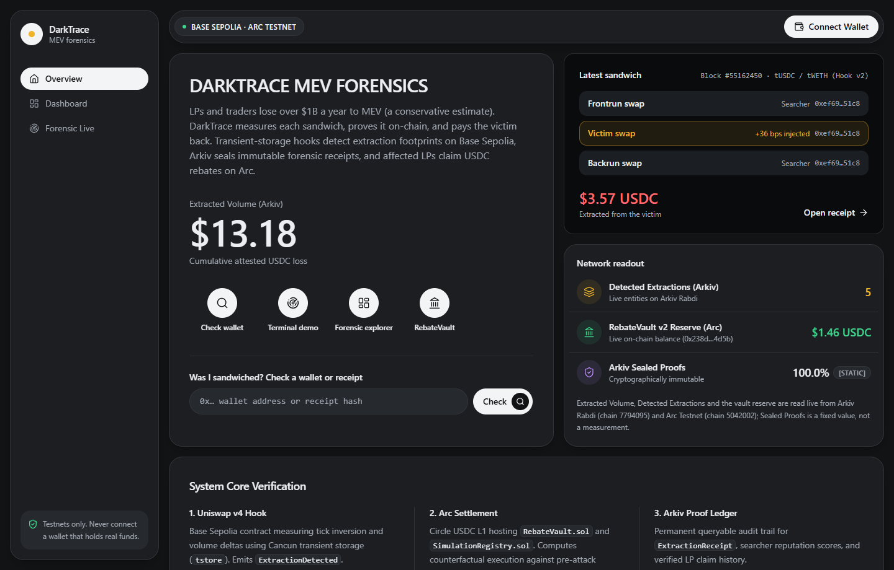
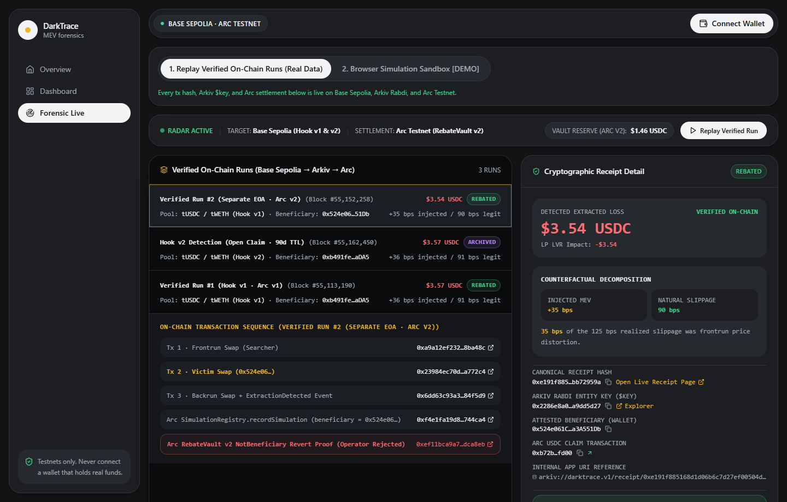
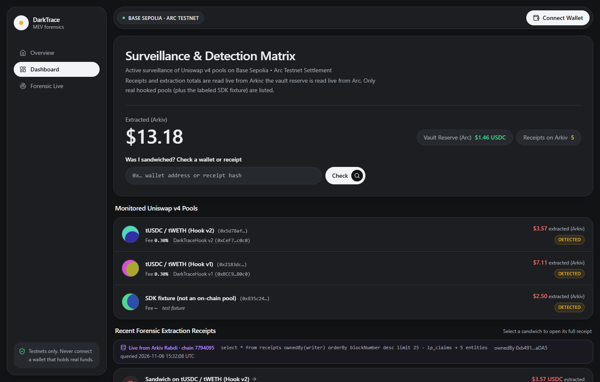
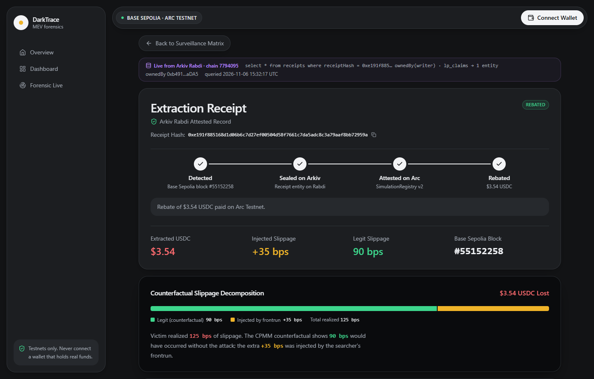

# DarkTrace Visual Evidence & Screenshot Catalog

This catalog documents the visual and structural evidence of the DarkTrace system across the Uniswap v4 hook (`v1` & `v2`), Arc Testnet USDC vault (`v2`), Arkiv Rabdi ledger, and live wallet-style dark web application.

---

## 1. Application Interface Views (Live Hosted on Vercel)

### A. Overview & Live Network Readout (`/`)

- **URL**: [https://darktrace-lovat.vercel.app](https://darktrace-lovat.vercel.app)
- **Key Visual Evidence**:
  - Live cumulative extracted volume read from Arkiv Rabdi (`$13.18` across `5` entities).
  - Latest sandwich preview (`Block #55162450 · tUSDC / tWETH (Hook v2)`).
  - Live `RebateVault` v2 USDC reserve on Arc Testnet (`$1.46 USDC` at `0x238d…4d5b`).
  - Instant wallet address or receipt hash lookup bar (`Was I sandwiched?`).

### B. Interactive Forensic Terminal (`/demo`)

- **URL**: [https://darktrace-lovat.vercel.app/demo](https://darktrace-lovat.vercel.app/demo)
- **Key Visual Evidence**:
  - **Dual-Mode Selector**: `1. Replay Verified On-Chain Runs (Real Data)` and `2. Browser Simulation Sandbox [DEMO]`.
  - **3 Verified On-Chain Runs**:
    1. `Verified Run #2 (Separate EOA · Arc v2)` (Block `#55,152,258`, `$3.54 USDC`, `REBATED`).
    2. `Hook v2 Detection (Open Claim · 90d TTL)` (Block `#55,162,450`, `$3.57 USDC`, `ARCHIVED`).
    3. `Verified Run #1 (Hook v1 · Arc v1)` (Block `#55,113,190`, `$3.57 USDC`, `REBATED`).
  - Complete clickable transaction sequence including the `NotBeneficiary` revert proof (`0xef11bca9…dca8eb`) and Victim EOA claim (`0xb72b…fd00`).

### C. Forensics Surveillance Matrix (`/dashboard`)

- **URL**: [https://darktrace-lovat.vercel.app/dashboard](https://darktrace-lovat.vercel.app/dashboard)
- **Key Visual Evidence**:
  - Active Uniswap v4 monitored pools on Base Sepolia: `tUSDC / tWETH (Hook v2)` (`0xCeF7…c0c0`) and `tUSDC / tWETH (Hook v1)` (`0xBCC9…80c0`), plus the explicitly labeled `SDK fixture (not an on-chain pool)`.
  - Live on-chain Arc `RebateVault` v2 reserve (`$1.46 USDC`) and live Arkiv Rabdi query strip (`chain 7794095`).

### D. Cryptographic Extraction Receipt (`/receipt/0xe191f885…`)

- **URL**: [https://darktrace-lovat.vercel.app/receipt/0xe191f885168d1d06b6c7d27ef00504d58f7661c7da5adc8c3a79aaf8bb72959a](https://darktrace-lovat.vercel.app/receipt/0xe191f885168d1d06b6c7d27ef00504d58f7661c7da5adc8c3a79aaf8bb72959a)
- **Key Visual Evidence**:
  - 4-stage pipeline completion tracker (`Detected` Block `#55152258` → `Sealed on Arkiv` → `Attested on Arc` `SimulationRegistry v2` → `Rebated` `$3.54 USDC`).
  - Counterfactual slippage decomposition bar: `90 bps` legit counterfactual slippage vs `+35 bps` injected frontrun slippage (`125 bps` total realized).

---

## 2. On-Chain & Explorer Evidence

### E. Uniswap v4 Hooks on Base Sepolia
- **Hook v2 (`0x00C0` flags, salt `0x180d`)**: [`0xCeF7a999885D93f23Beeb7D319A83F2949B2c0c0`](https://sepolia.basescan.org/address/0xCeF7a999885D93f23Beeb7D319A83F2949B2c0c0)
- **Hook v1 (`0x00C0` flags, salt `0x139d`)**: [`0xBCC9e1C474Ed195b3791f2c41EdAC2a25c5b80c0`](https://sepolia.basescan.org/address/0xBCC9e1C474Ed195b3791f2c41EdAC2a25c5b80c0)

### F. Arc Testnet Rebate Vault v2 (Beneficiary-Gated)
- **SimulationRegistry v2**: [`0xd501D47b246438A18C8a0BFFCF10338CfBB661a2`](https://explorer.testnet.arc.io/address/0xd501D47b246438A18C8a0BFFCF10338CfBB661a2)
- **RebateVault v2**: [`0x238dE56E52A3F6C6708952052e6a20E5102b4d5b`](https://explorer.testnet.arc.io/address/0x238dE56E52A3F6C6708952052e6a20E5102b4d5b)

### G. Arkiv Rabdi Testnet Verified Entities
- **Verified Run #2 Receipt (`$3.54 USDC`)**: [`0x2286e8a00e389f51ea21e3d5280f2078b54b4b2456842783962416c1a9dd5d27`](https://rabdi.explorer.arkiv.network/entity/0x2286e8a00e389f51ea21e3d5280f2078b54b4b2456842783962416c1a9dd5d27)
- **Verified Run #2 Claim (`REBATED`)**: [`0x45dcfc2de3a9b1e6738ef67dcfa323c202f28683da820c35cf0f27d3b6d89a35`](https://rabdi.explorer.arkiv.network/entity/0x45dcfc2de3a9b1e6738ef67dcfa323c202f28683da820c35cf0f27d3b6d89a35)
- **Hook v2 Open-Claim Receipt (90-day TTL)**: [`0x259dc2884aab483503458ce1ebb716c4e90bf156eadfaaa2e9761d2ec60b0fd2`](https://rabdi.explorer.arkiv.network/entity/0x259dc2884aab483503458ce1ebb716c4e90bf156eadfaaa2e9761d2ec60b0fd2)
